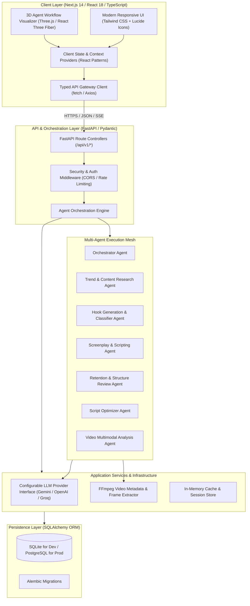

# CINEHA AI — System Architecture Document

## 1. High-Level Architectural Overview

CINEHA AI employs a decoupled, multi-tier micro-service-ready architecture comprising a high-performance Next.js 14 frontend, an asynchronous Python FastAPI orchestration backend, an event-driven multi-agent framework, and a persistent relational database tier.

---

## 2. Layered Breakdown

### Layer 1: Frontend Presentation Tier (`apps/web`)
- **Framework:** Next.js 14 (App Router) with TypeScript.
- **Styling & Theming:** Tailwind CSS with custom cine-dark palette (`#0B0F17`, `#111827`, `#6366F1`, `#EC4899`, `#10B981`) and glassmorphic surface textures.
- **3D Interactive Graphics:** Three.js + `@react-three/fiber` + `@react-three/drei` for rendering the live agent pipeline graph, particle transitions, and pipeline pulse waves.
- **Accessible Fallback:** A parallel accessible SVG/HTML 2D diagram equipped with ARIA live regions and keyboard navigation for users with low-spec hardware or `prefers-reduced-motion`.

### Layer 2: API & Orchestration Gateway (`apps/api`)
- **Framework:** FastAPI (Python 3.9+) with asynchronous route handlers (`async/await`).
- **Data Validation:** Pydantic v2 schemas providing strict compile-time and runtime type safety.
- **Streaming & Real-Time Telemetry:** Server-Sent Events (SSE) or WebSocket streaming for real-time agent thought states, step completions, and token streams.
- **Resilience:** Circuit breaker, timeout budgets (max 45s per agent call), exponential backoff retries, and comprehensive error masking.

### Layer 3: The Multi-Agent Mesh
The system separates specialized agent domains rather than relying on a single monolithic prompt:
1. **Orchestrator Agent:** Parses user intent (natural language or structured forms), selects optimal pipeline branch, orchestrates inter-agent data passing, and aggregates execution metrics.
2. **Trend & Research Agent:** Synthesizes platform-specific viral formats, analyzes niche dynamics, and marks sources as verified vs inferred.
3. **Hook Analyst Agent:** Deploys psychological hook taxonomies (Curiosity, Contrarian, Problem-Solution, etc.) tailored for 0–3 second retention.
4. **Script Generator Agent:** Produces structured 2-column scripts with voiceover, visual cues, text overlays, and pacing markers in English, Telugu, and Tenglish.
5. **Retention/Structure Review Agent:** Executes rubric-based heuristic scoring on hook retention, narrative pacing, filler density, and CTA strength.
6. **Script Optimizer Agent:** Computes structured diffs, refines wording while respecting creator persona, and presents side-by-side versions.
7. **Video Analysis Agent:** Integrates FFmpeg frame-sampling and visual heuristics to audit uploaded shorts for pacing, audio clarity, and framing.

### Layer 4: Data & Persistence Tier
- **ORM:** SQLAlchemy 2.0 with async engine support.
- **Engines:** Zero-dependency SQLite for immediate local development; seamlessly switchable to PostgreSQL via environment connection string (`DATABASE_URL`).
- **Audit Trails:** Immutable agent execution runs, script version trees, and creator profile configurations.

---

## 3. Security & Isolation Boundaries
- **Environment Confidentiality:** Zero secret leakage in client bundles or log outputs.
- **Ephemeral Media Storage:** Uploaded video files for analysis are isolated to a sandboxed `/tmp/cineha_uploads/` scratch directory and immediately purged upon analysis completion.
- **Input Sanitization:** Regex-based sanitization and prompt injection shields before passing text to LLM providers.
- **CORS & Rate Limiting:** Strict allowed-origin headers for frontend domains and IP-based rate limiting on intensive generation endpoints.
