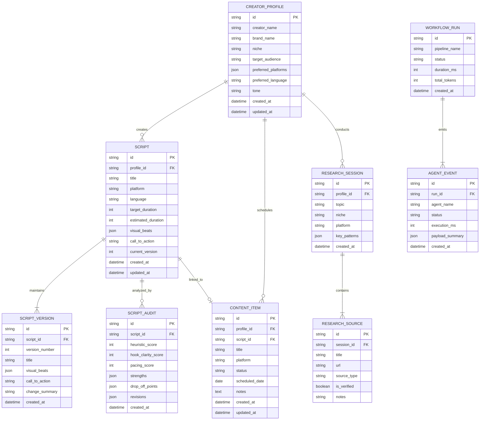

# CINEHA AI — Database Schema & Data Models

This document defines the relational database architecture, entity relationships, indexes, and migration strategies implemented via SQLAlchemy 2.0.

---

## 1. Entity-Relationship Diagram (ERD)

---

## 2. Table Specifications & Indexes

1. **`creator_profiles`**
   - Primary Key: `id` (`VARCHAR(36)`, UUIDv4)
   - Indexes: `ix_creator_profiles_brand_name`

2. **`scripts`**
   - Primary Key: `id` (`VARCHAR(36)`, UUIDv4)
   - Foreign Key: `profile_id` references `creator_profiles.id` on delete CASCADE.
   - Indexes: `ix_scripts_platform`, `ix_scripts_created_at`, `ix_scripts_profile_id`

3. **`script_versions`**
   - Unique Composite Constraint: `(script_id, version_number)`
   - Indexes: `ix_script_versions_script_id`

4. **`content_items`**
   - Primary Key: `id` (`VARCHAR(36)`, UUIDv4)
   - Indexes: `ix_content_items_scheduled_date`, `ix_content_items_status`

---

## 3. Storage Engine Compatibility & Migrations

- **Development:** Zero-configuration SQLite (`sqlite+aiosqlite:///./cineha_ai.db`). All JSON columns are serialized safely using native `JSON` types supported across SQLite 3.38+ and PostgreSQL.
- **Production:** Fully compatible with PostgreSQL 15+ without code modifications via the `DATABASE_URL` environment variable.
- **Migration Engine:** Alembic for automatic schema evolution and rollback capability.
